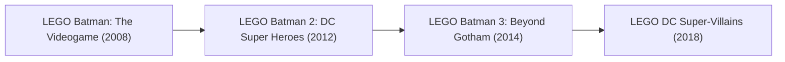

# Game Research: LEGO Batman (TT Games)

## 1. Franchise Overview
The *LEGO Batman* series marks TT Games' expansion into DC Comics, introducing original superhero narrative writing, suit-swapping mechanics, and eventual expansive open worlds.

---

## 2. Release & Re-release Chronology

### Game Releases Included in this Title Group:
1. **LEGO Batman: The Videogame (2008):**
   - Dual-campaign structure (Hero story vs. Villain story).
   - Introduces Batman and Robin specialized suit dispensers (Glide, Demolition, Magnet, Hazard).
   - Platforms: PS3, Xbox 360, Wii, PS2, PSP, DS, PC, Mac.
2. **LEGO Batman 2: DC Super Heroes (2012):**
   - Major franchise milestone: First TT Games LEGO title to feature **full voice acting** and a **continuous open-world hub** (Gotham City).
   - Introduces the Justice League (Superman, Wonder Woman, Flash, Green Lantern).
   - Engine: Generation 2 TT Engine (`PakDat v1.01`).
3. **LEGO Batman 3: Beyond Gotham (2014):**
   - Expands scope to cosmic space environments and Lantern worlds (Odym, Zamaron, Qward).
   - Suit wheel mechanics replace fixed suit pads.
   - Platforms: PS4, Xbox One, PS3, Xbox 360, Wii U, PS Vita, 3DS, PC, iOS.
4. **LEGO DC Super-Villains (2018):**
   - Narrative centering on the Legion of Doom against the Justice Syndicate.
   - Custom rookie player character integrated into the core cinematic storyline.
   - Advanced PBR rendering of LEGO brick plastic and weathering.

---

## 3. Engine & Format Notes
- *LEGO Batman 2* shares extensive engine code with *LEGO Harry Potter: Years 5-7* (both 2011–2012 TT Engine generation).
- Audio and dialog pipelines in Batman 2/3 serve as the reference standard for spoken dialogue parsing in Remake Engine research.

