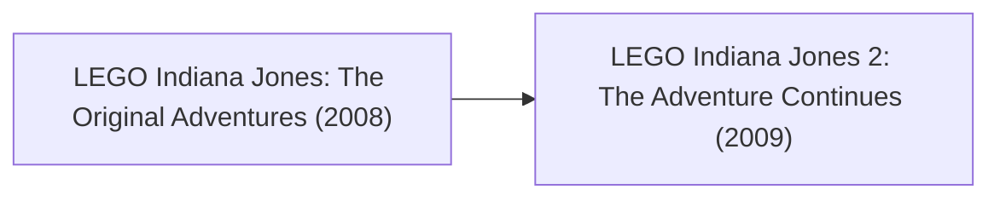

# Game Research: LEGO Indiana Jones (TT Games)

## 1. Franchise Overview
*LEGO Indiana Jones* adapted the Lucasfilm cinematic franchise, introducing interactive prop pickups, environmental phobias, whip platforming mechanics, and the dynamic split-screen camera system.

---

## 2. Release & Re-release Chronology

### Game Releases Included in this Title Group:
1. **LEGO Indiana Jones: The Original Adventures (2008):**
   - Covers the original classic trilogy: *Raiders of the Lost Ark*, *Temple of Doom*, and *The Last Crusade*.
   - Introduced tool/weapon pickups (swords, guns, torches, bottles) and character phobias (Indy's snake fear, Willie's spider fear).
   - Barnett College hub layout.
   - Platforms: PS3, Xbox 360, Wii, PS2, PSP, DS, PC, Mac.
2. **LEGO Indiana Jones 2: The Adventure Continues (2009):**
   - Major technological milestone: Introduced TT Games' patented **dynamic procedural split-screen**, allowing two players to move independently across the map without camera clamping.
   - Included *Kingdom of the Crystal Skull* alongside reworked original trilogy levels.
   - Introduced an in-game Level Builder allowing players to construct custom LEGO environments and adventure missions.
   - Platforms: PS3, Xbox 360, Wii, PSP, DS, PC.

---

## 3. Engine & Format Notes
- The dynamic split-screen technology debuted in *LEGO Indiana Jones 2* became a signature feature across all subsequent TT Games titles, including *LEGO Harry Potter*.
- Level creation data formats in Indy 2 provide valuable insight into TT Games' scene graph and entity placement serialization.

