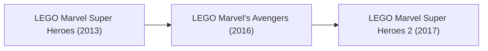

# Game Research: LEGO Marvel (TT Games)

## 1. Franchise Overview
*LEGO Marvel* represents TT Games' highest-selling comic book adaptations, bringing the Marvel Comics and Marvel Cinematic Universe pantheon into the LEGO universe with massive character rosters, big-figure mechanics, and dense open-world hubs.

---

## 2. Release & Re-release Chronology

### Game Releases Included in this Title Group:
1. **LEGO Marvel Super Heroes (2013):**
   - Original comic-inspired narrative uniting the Avengers, X-Men, Fantastic Four, Spider-Man, and cosmic entities against Galactus and Doctor Doom.
   - Massive open-world Manhattan hub and S.H.I.E.L.D. Helicarrier jump point.
   - Introduced "Big-fig" character transformations (Hulk, Abomination, Juggernaut).
   - Platforms: PS4, Xbox One, PS3, Xbox 360, Wii U, PC, Switch (2021 re-release).
2. **LEGO Marvel's Avengers (2016):**
   - Direct adaptation of *The Avengers* and *Avengers: Age of Ultron*, plus Phase 2 MCU chapters.
   - Introduced dynamic team-up combo moves and localized hub zones (Asgard, Malibu, Sokovia, Washington D.C.).
   - Platforms: PS4, Xbox One, PS3, Xbox 360, Wii U, PS Vita, 3DS, PC.
3. **LEGO Marvel Super Heroes 2 (2017):**
   - Chronopolis hub connecting 18 diverse Marvel regions across time and space (Kang the Conqueror storyline).
   - Time manipulation mechanics and 4-player competitive battle arenas.
   - Platforms: PS4, Xbox One, Nintendo Switch, PC.

---

## 3. Engine & Format Notes
- *LEGO Marvel Super Heroes (2013)* bridges the Generation 2 and Generation 3 engine transitions, being one of the first TT Games titles released across both 7th-gen (PS3/360) and 8th-gen (PS4/XOne) platforms.
- Big-fig character skeletal meshes and dynamic deformation shaders represent an important milestone for skeletal animation reverse engineering.

