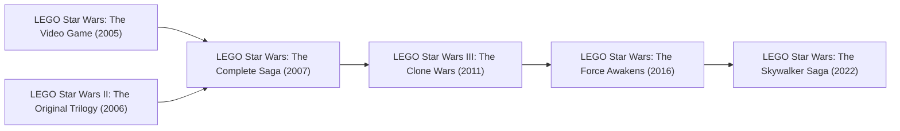

# Game Research: LEGO Star Wars (TT Games)

## 1. Franchise Overview
*LEGO Star Wars* is the foundational pillar of the modern TT Games formula, initiating the franchise in 2005 and continuing through the monumental release of *The Skywalker Saga* in 2022.

---

## 2. Release & Re-release Chronology

### Game Releases Included in this Title Group:
1. **LEGO Star Wars: The Video Game (2005):**
   - Covers Prequel Trilogy (Episodes I–III).
   - Platforms: PS2, Xbox, GameCube, PC, GBA.
   - First introduction of stud collection, true jedi counters, minikits, and cantina hub.
2. **LEGO Star Wars II: The Original Trilogy (2006):**
   - Covers Original Trilogy (Episodes IV–VI).
   - Platforms: PS2, Xbox, Xbox 360, GameCube, PC, PSP, Nintendo DS.
   - Introduced custom character creation and vehicular free play.
3. **LEGO Star Wars: The Complete Saga (2007):**
   - Re-release / definitive compilation of Episodes I–VI with upgraded visuals, online co-op, new levels, and redone Episode I podrace.
   - Platforms: PS3, Xbox 360, Wii, PC, iOS, Android.
4. **LEGO Star Wars III: The Clone Wars (2011):**
   - Covers the animated *The Clone Wars* series (Seasons 1 & 2).
   - Introduced large-scale real-time strategy ground battles and dual-character story swapping.
   - Archive format: Generation 2 `PakDat v1.01`.
5. **LEGO Star Wars: The Force Awakens (2016):**
   - Covers Episode VII plus supplemental prequel lore.
   - Introduced multi-build puzzle mechanics, cover-based blaster shooting, and dogfighting arenas.
6. **LEGO Star Wars: The Skywalker Saga (2022):**
   - Complete rebuild of Episodes I–IX on the brand-new proprietary **NTT Engine**.
   - Features over-the-shoulder third-person camera, combo-based melee combat, class skill trees, and extensive open-galaxy exploration.

---

## 3. Engine & Asset Notes
- **Archive Evolution:** Early titles used compressed `.DAT` archives without modern canaries. *The Clone Wars* standardizes `PakDat v1.01`. *The Skywalker Saga* departs entirely from legacy NuP architectures to NTT's package format.
- **Reverse Engineering Target:** *The Complete Saga* (PS3/PC) serves as the primary benchmark for TT Games' 6th/7th-gen transition mechanics.

