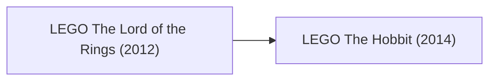

# Game Research: LEGO The Lord of the Rings & The Hobbit (TT Games)

## 1. Franchise Overview
The Tolkien adaptations represent TT Games' grandest scale 7th-generation open-world games, featuring direct audio lines sampled from the Peter Jackson motion pictures, an extensive Middle-earth seamless overland map, and Mithril blacksmith crafting.

---

## 2. Release & Re-release Chronology

### Game Releases Included in this Title Group:
1. **LEGO The Lord of the Rings (2012):**
   - Covers *The Fellowship of the Ring*, *The Two Towers*, and *The Return of the King*.
   - Features a continuous open-world recreation of Middle-earth (from the Shire through Rivendell, Moria, Helm's Deep, and Mordor).
   - Introduces the Mithril Item Forge, inventory backpack wheel, and vocal dialogue lifted directly from the film masters.
   - Platforms: PS3, Xbox 360, Wii, PC, PS Vita, 3DS, DS, iOS, Android.
2. **LEGO The Hobbit (2014):**
   - Covers *An Unexpected Journey* and *The Desolation of Smaug*.
   - Introduced Buddy-Up dual attacks, mining and looting material systems (copper, iron, silver, ruby), and the instruction-build mini-game.
   - Platforms: PS4, Xbox One, PS3, Xbox 360, Wii U, PS Vita, 3DS, PC, Mac.

---

## 3. Engine & Format Notes
- The overland streaming technology in *The Lord of the Rings* pushed the PS3 `cellFs` and FAT32 streaming architecture to its limit, utilizing high-performance asynchronous IO loops in `EBOOT.BIN`.
- Inventory item serialization and crafting recipes provide excellent comparative data against the spell assignment systems of *LEGO Harry Potter*.

