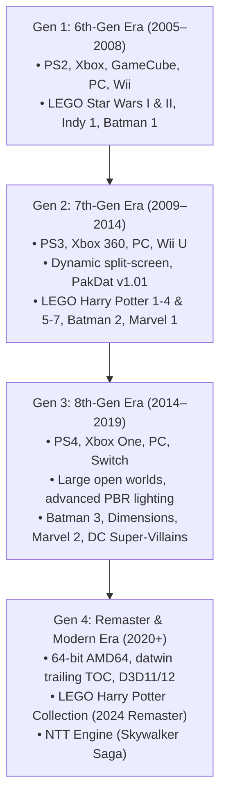

# Developer Research: Traveller's Tales (TT Games)

## 1. Overview & History
Traveller's Tales (now part of **TT Games**, a Warner Bros. Interactive Entertainment subsidiary) is the primary architect and developer behind the LEGO video game franchise from 2005 to the present day. Founded in 1989 by Jon Burton, Traveller's Tales established the LEGO action-adventure formula with *LEGO Star Wars: The Video Game* (2005), which merged brick-building mechanics, accessible puzzle solving, slapstick pantomime humor, and drop-in/drop-out cooperative multiplayer.

---

## 2. Proprietary Engine Evolution

TT Games developed games primarily on their proprietary in-house engine (commonly referred to historically as the **NuP Engine** or **TT Engine**), which underwent several distinct generational iterations:

### Generational Details

### Generation 1 (2005–2008)
- **Key Games:** *LEGO Star Wars: The Video Game* (2005), *LEGO Star Wars II: The Original Trilogy* (2006), *LEGO Star Wars: The Complete Saga* (2007), *LEGO Indiana Jones: The Original Adventures* (2008), *LEGO Batman: The Videogame* (2008).
- **Core Technology:** Fixed-function and early shader pipelines targeting PlayStation 2, Xbox, Nintendo GameCube, PC, and Wii. Fixed camera angles, single-screen co-op tethering.

### Generation 2 (2009–2014)
- **Key Games:** *LEGO Indiana Jones 2: The Adventure Continues* (2009), *LEGO Harry Potter: Years 1–4* (2010), *LEGO Star Wars III: The Clone Wars* (2011), *LEGO Pirates of the Caribbean* (2011), *LEGO Harry Potter: Years 5–7* (2011), *LEGO Batman 2: DC Super Heroes* (2012), *LEGO The Lord of the Rings* (2012), *LEGO Marvel Super Heroes* (2013), *LEGO The Hobbit* (2014).
- **Core Technology:**
  - Dynamic procedural split-screen (patented by TT Games) enabling players to roam freely while merging when nearby.
  - Introduction of full voice acting starting in *LEGO Batman 2* and *LEGO Lord of the Rings*.
  - Archive system: **`PakDat v1.01`** (`GAME*.DAT`), split into multi-volume parts to accommodate FAT32 console file systems.
  - Middleware: Miles Sound System / CellOS audio, RAD Game Tools Bink Video (`.bik`).

### Generation 3 (2014–2019)
- **Key Games:** *LEGO Batman 3: Beyond Gotham* (2014), *LEGO Dimensions* (2015), *LEGO Marvel's Avengers* (2016), *LEGO Worlds* (2017), *LEGO Marvel Super Heroes 2* (2017), *LEGO DC Super-Villains* (2018), *The LEGO Movie 2 Videogame* (2019).
- **Core Technology:** Extensive open-world hub transitions, physical "Toys-to-Life" hardware integration via USB NFC peripheral in *LEGO Dimensions*, physically-based rendering (PBR) approximations on minifigure plastic materials.

### Generation 4: Remasters & Modern Technology (2020+)
- **Key Games:** *LEGO Star Wars: The Skywalker Saga* (2022, built on the newly engineered **NTT Engine**), *LEGO Harry Potter Collection* (September 2024 Steam / PC remaster release).
- **Core Technology:**
  - 64-bit AMD64 architecture (`x64FinalD11Static`).
  - Next-generation archive packaging: **`datwin`** with trailing Table of Contents delimited by the `0x12345678` canary signature.
  - Paired package index/data system (`.pkiwin` / `.pkdwin`).
  - FMOD audio engine and precompiled multi-tier shader bytecode blobs (`shaderblob_pc.blob`).

---

## 3. Game Title Research Directory

Each specific game title research directory is structured under this developer folder:

- [`Lego_Harry_Potter/`](Lego_Harry_Potter/README.md) — *LEGO Harry Potter: Years 1-4*, *Years 5-7*, and the *2024 Collection Remaster*.
- [`Lego_Star_Wars/`](Lego_Star_Wars/README.md) — *LEGO Star Wars* franchise (Original Game through *The Skywalker Saga*).
- [`Lego_Batman/`](Lego_Batman/README.md) — *LEGO Batman* franchise (Batman 1, 2, 3, and *DC Super-Villains*).
- [`Lego_Indiana_Jones/`](Lego_Indiana_Jones/README.md) — *LEGO Indiana Jones: The Original Adventures* and *The Adventure Continues*.
- [`Lego_The_Lord_of_the_Rings/`](Lego_The_Lord_of_the_Rings/README.md) — *LEGO The Lord of the Rings* and *LEGO The Hobbit*.
- [`Lego_Marvel/`](Lego_Marvel/README.md) — *LEGO Marvel Super Heroes*, *Avengers*, and *Marvel Super Heroes 2*.
- [`Lego_Pirates_of_the_Caribbean/`](Lego_Pirates_of_the_Caribbean/README.md) — *LEGO Pirates of the Caribbean: The Video Game*.

