# Developer Research: Traveller's Tales (TT Games & TT Fusion)

## 1. Overview & History
Traveller's Tales (now part of **TT Games**, a Warner Bros. Games subsidiary, alongside handheld/port studio **TT Fusion**) is the primary developer behind the LEGO action-adventure video game franchise from 2005 to the present day. Founded in 1989 by Jon Burton, Traveller's Tales built its proprietary cross-platform C++ game engine family (**`Nu2` / `NU20` -> `NXG` -> `DX11` -> `NTT`**), evolving from 6th-generation consoles (PS2, Original Xbox, GameCube) through 7th/8th-generation consoles and modern 64-bit PC remasters.

---

## 2. Proprietary Engine Taxonomy & Sub-Engine Evolution

Based on direct binary inspection of retail executables/archives and cross-referenced community reverse engineering (**TTModding**, **TTGames-Workshop**, **BrickBench**, **TTGames Explorer Rebirth**), TT Games' proprietary engine divides into the following generations and sub-engine variants:

```mermaid
flowchart TD
    P["Pre-LEGO Nu2 Era (1997–2004)<br>• Sonic R (.TER), Wrath of Cortex, Haven, Finding Nemo<br>• Early NU20 chunked scene container"] --> E1
    E1["Era 1: PS2 Sub-Engine — NUP Variant (2005–2006)<br>• LEGO Star Wars I & II, Bionicle Heroes<br>• Unpacked XDVDFS (Xbox/360) or TOC v-1 GAME.DAT (PS2/PC)<br>• .nup/.nux/.nx2/.gsc, .hgp/.hgx/.hx2/.ghg, .ani/.an3, .cut/.cu2"] --> E2
    E2["Era 2: PS2-HD Sub-Engine — PC.GHG Classic (2007–2008)<br>• The Complete Saga, Indiana Jones 1, LEGO Batman 1<br>• TOC v-2 / v-3, TtPathHash (0x00199933)<br>• Self-relative NU20 .gsc & _pc.ghg, .an3 (4INA..8INA), .cu2"] --> E3A
    E3A["Era 3a: Next-Gen (NXG) — Creator Variant (2009–2010)<br>• Indiana Jones 2, LEGO Harry Potter: Years 1–4<br>• PakDat v1.01 TOC v-3 / v-4, dynamic split-screen<br>• NuFileHeader (.CC4+HSER), NuSerializer StreamInfo (.cd, .as, .apj, .led)"] --> E3B
    E3B["Era 3b: Next-Gen (NXG) — Builder Variant (2011)<br>• Star Wars III, Pirates of the Caribbean, Harry Potter: Years 5–7<br>• PakDat v1.01 TOC v-4 / v-5, LZ2K chunked compression<br>• Deferred lighting, .cpd ragdoll physics, .sf scripts"] --> E3C
    E3C["Era 3c: Next-Gen (NXG) — Gotham Variant (2012–2013)<br>• LEGO Batman 2, Lord of the Rings, LEGO City Undercover<br>• Open-world streaming hubs, full voice acting<br>• Transition from .an3/.cu2 to .an4 (ANI-B) & .cu3 (v16–20)"] --> E4A
    E4A["Era 4a: Next-Gen (NXG) — Cinema Variant DX9/DX11 (2013–2015)<br>• Marvel 1, LEGO Movie 1, Hobbit, Batman 3, Jurassic World, Dimensions<br>• Split .HDR + .DAT (TOC v-7 with ROTV & DFLT) & .CC40TAD (v-8)<br>• CMP2 LZMA install archives, .tsh sprite sheets, .cbx/.cbs, .res"] --> E4B
    E4B["Era 4b: Next-Gen (NXG) — TFA Variant DX11 & Remasters (2016–2024)<br>• Avengers, Force Awakens, Worlds, Ninjago, Marvel 2, DC Super-Villains<br>• .CC40TAD v1/v2 (TOC v-8..-12, 64-bit FNV-1a, ZIPX RC4+Deflate)<br>• LEGO Harry Potter Collection (2016/2024): .datwin (LZHAM) + .pkiwin/.pkdwin"] --> E5
    E5["Era 5: NTT ('Entity') Engine (2022)<br>• LEGO Star Wars: The Skywalker Saga<br>• .CC40TAD TOC v-11/-12 with OODL (Oodle Mermaid)<br>• .tsh v11 + external .texture containers"]
```

---

## 3. Archive Container Evolution (`.DAT` / `PakDat` / `.HDR` / `.datwin` / `.CC40TAD`)

| Container / TOC Version | Observed Titles & Platforms | Header Layout | Entry Stride & Offset Formula | Name Tree & Hash Table | Compression Codecs |
| :--- | :--- | :--- | :--- | :--- | :--- |
| **Unpacked Disc Filesystem** | *LSW1* (2005 Xbox), *LSW2* (2006 Xbox & Xbox 360) | Native XDVDFS (`MICROSOFT*XBOX*MEDIA`) | Direct filesystem sectors (`Sec * 2048`) | Native XDVDFS directory B-tree | File-level `.fpk`/`.pak` (`0x1234567A`) on Xbox 360 |
| **Classic TOC `Version = -1`** | *LSW1* (2005 PS2), *LSW2* (2006 PS2/PC) | 8-byte header (`int32 TocOffset`, `uint32 TocSize`), zero-padded to `0x800` | 16 B (`uint32 DirectOffset`, `CompSize`, `UncompSize`, `Flags`) | 8-byte `NameNodes[M]` + `StringTable[S]`. **No trailing hash array** (`RemBytes = 0`). | Raw (`0`) or file-level `RNC\x02` (`52 4E 43 02` on PS2) |
| **Classic TOC `Version = -2` / `-3`** | *TCS* (2007), *Indiana Jones 1 & 2* (2008–2009), *Batman 1* (2008) | 8-byte or 57-byte `PakDat` header | 16 B (`(OffsetSector << 8) + SubSectorOffset`) | 8-byte `NameNodes[M]` + `StringTable[S]` + `uint32 TtPathHash[N]` + 8-byte footer | Raw (`0`), `RFPK`, or `Deflate_v1.0` inner files |
| **`PakDat v1.01` TOC `Version = -4`** | *HP Years 1–4* (2010), *HP Years 5–7* (2011), *Batman 2* (2012 WinSteam) | **57-byte** header: `int32 RawTocOffset`, `uint32 TocSize`, 49-byte `BEGIN_APP_ID_STRINGPakDat v1.01END_APP_ID_STRING\0` | 16 B (`(OffsetSector << 8) + SubSectorOffset`) | 8-byte `NameNodes[M]` (`-Child == sequential EntryIndex`) + `StringTable[S]` + `uint32 TtPathHash[N]` + 8-byte footer | `0` = Raw, `2` = Chunked `LZ2K` (12B header: `"LZ2K"`, `UncompSize`, `CompSize`) |
| **Classic TOC `Version = -5` / `-6`** | *LOTR* (2012), *Marvel 1* (2013), *Batman 3* (2014) | 8-byte or 57-byte `PakDat` header (or `.HDR` split) | 16 B (`(OffsetSector << 8) + SubSectorOffset`) | **12-byte** `NameNodes[M]` (adds `uint32 Reserved`) + `StringTable[S]` + `uint32 TtPathHash[N]` | `0` = Raw, `2` = `LZ2K`, `3` = `DFLT` |
| **Split `.HDR` + `.DAT` TOC `Version = -7`** | *LEGO Dimensions* (2015 PS3 `GAME*.DAT` + `GAME*.HDR`, `INSTALL0_*.HDR`) | `.DAT`: 8-byte header (`RawTocOffset`, `TocSize`). `.HDR`: 4-byte BE `TocSize` + full TOC mirror. | 16 B (`(OffsetSector << 8) + SubSectorOffset`) | **12-byte** `NameNodes[M]` (`-Child == non-sequential EntryIndex`, 100% hash-verified) + `StringTable[S]` + `uint32 TtPathHash[N]` + `RootPrefix` + 24 zero bytes + two `"ROTV"` (`16 * N` B) arrays | `0` = Raw, `3` = Chunked `DFLT` (12B header: `"DFLT"`, `CompSize`, `UncompSize` + RFC 1951 Deflate). `INSTALL0_*.DAT` wrapped in `CMP2CMP2CMP2CMP2` + 16B hash + 8B size + LZMA (`5D 00 00 00 02`). |
| **Big-Endian `.CC40TAD` TOC `-8`..`-12`** | *Avengers*, *Force Awakens*, *Worlds*, *Ninjago*, *Marvel 2*, *DC Super-Villains*, *Skywalker Saga* | `.CC40TAD` (`4CC.DAT0`) Big-Endian header + sentinel `0x1000FFFF` | 16 B (`-8`, `-10`) or 20 B (`-11`, `-12` with 64-bit offsets) | 10-byte (`v1`) or 12-byte (`v2`) nodes + `uint32` TT-FNV or `uint64` standard FNV-1a hashes + optional `ROTV` / mode arrays | `DFLT` (Deflate), `ZIPX` (RC4 + Deflate), `OODL` (Oodle Mermaid in *Skywalker Saga*) |
| **Remaster `.datwin` TOC `Version = -1`** | *LEGO Harry Potter Collection* (2024 PC Steam `harry1*.datwin`, `harry2*.datwin`) | 16-byte header (`int64 TocOffset`, `uint64 TocSize`) | 24 B (`uint64 Offset`, `0x12345678` canary, `uint32 CompSize`, `uint32 UncompSize`, `uint32 Flags`) | **No name tree or string table** (`TocSize == 8 + 28 * N`); only `uint32 TtPathHash[N]` | `0x00000000` = Raw, `0x04040404` = Raw LZHAM (`0E C6`, 32 KiB dict `log2=15`, flags `5`) |

---

## 4. Cross-Game Format Distribution (Shared vs. Era/Game-Specific)

### 4.1 Core Formats Shared Across Multiple Generations
- **`.gsc` / `.ghg`**: Primary scene geometry and character/prop model containers (`NU20` self-relative pointer image in Classic; `.CC4` + `HSER` + `02UN` + `OFNI`/`LBTN`/`HGXT`/`HSEM`/`LTMU`/`LOGH`/`PSID` in NXG/DX11; `RNC\x02`-wrapped `NU20` on *LSW1* PS2).
- **`.tex` / `.dds`**: Surface textures (raw DDS or count-prefixed DDS in Classic; `NuTextureSet` `TSXT` + `HGXT` in NXG).
- **`.pak` / `.pac` / `.fpk`**: Sub-package archives with little-endian magic `0x1234567A` (`7A 56 34 12`), 20-byte entry descriptors, and additive filename checksum `0x12345678 + Σ toupper(c)`.
- **`.ft2`**: Bitmap font descriptors (`NuFont`; `TNFN` / `NFNT` at `+0x08` in NXG).
- **`.giz` / `.git`**: Interactive level gizmos, obstacles, and camera/environment options (`GitOptions {`).
- **`.scp`**: State-machine AI behavior scripts (`state Base { Conditions ... Actions ... }`).
- **`.ptl` / `.par` / `.sfx`**: Particle emitters, parameter curves, and sound effect event maps.
- **`.txt` / `.cfg` / `.csv` / `.ats` / `.fmv`**: Engine configuration, audio bus definitions, localization tables, animated texture scripts, and Bink/FMV video streams.

### 4.2 Era-Specific & Title-Specific Formats
- **Era 1 / Classic Only (*LEGO Star Wars I & II*, 2005–2006)**:
  - **Multi-platform Scene & Model Variants** (documented in `360_exlist`): `.nup` (PC scene), `.nux` / `.nx2` (Xbox v1/v2 scene), `.csc` (GameCube scene), `.nus` (`GSC0` + `VERS` scene), `.hgp` (PC model), `.hgx` / `.hx2` (Xbox v1/v2 model + `.hx2.htm` HTML exporter reports), `.chg` (GameCube model), `.phg` (PSP model).
  - **Relocated Memory-Image Animations & Cutscenes**: `.ani` (Gen 1 skeletal animation), `.bsa` / `.cbs` (facial blendshape animation), `.cut` / `.cct` (Gen 1 cutscene), `.an3` / `.ca3` (`4INA`/`5INA`/`6INA`/`8INA` 4-frame curve-compressed animation), `.cu2` / `.cc2` (relocated cutscene v516–520).
  - **Classic Level Subsystems**: `.ter` / `.ctr` (`100-byte` `TerrainMeshFace` collision), `.rtl` (`140-byte` real-time lights), `.ai2` (binary AI paths/triggers/spawns), `.for` (*Star Wars* Force-interactive objects), `.cns` (LEGO construction objects), `.bur` (debris bursts), `.lgt` (`VOI` lights), `.fsp` (flight splines).
- **Era 3 / NXG & Remasters (*Harry Potter*, *Batman 2*, *Dimensions*, 2009–2024)**:
  - **`EdFile` / `NuSerializer` Reflection Streams (`StreamInfo`)**: `.cd` (Character Definition), `.cpd` (Character Physics Descriptor), `.as` (Animation Set), `.apj` (Animation Project), `.led` (Level Editor Data).
  - **Physics & Scripting**: `.dno` (`SERIALISED` dynamic rigid-body physics objects), `.sf` (script functions), `.lua` (embedded Lua scripts in *HP Years 5–7* & *Batman 2*), `.aib` (compiled AI behaviors in *Batman 2*).
  - **Next-Gen Animation, Cutscenes & Dialogue**: `.an4` (`B-INA`/`DINA`/`EINA` skeletal animations in *Batman 2* & *Dimensions*), `.cu3` (`.CC4` + `HSER` + `3UC.`/`ATSC` cutscenes in *Batman 2* & *Dimensions*), `.cbx` / `.cbs` (`CBX_v1.0` Deflate & `CBY_v1.0` RC4+Deflate lip-sync/subtitles), `.sub` / `.subopt` (subtitle streams).
  - **Next-Gen Rendering & UI**: `.nxg_textures` (split texture payloads), `.pc_shaders` / `.ps3_shaders` / `shaderblob_pc.blob` (`SBLBVERS`), `.res` (`NuResource` dependency manifests — `10,125` in *Dimensions*), `.tsh` (`NuTextureSheet` sprite atlases in *Batman 3*, *Dimensions*, *Skywalker Saga*), `.gip`/`.gix`/`.gil` (GUI layouts in *Harry Potter*).
  - **Hardware Peripherals**: `.bin` (180-byte NTAG213 NFC Toy Tag dumps in *LEGO Dimensions*, storing encrypted character/vehicle IDs on pages `0x24..0x25`).

---

## 5. Game Title Research Directories

- [`Lego_Star_Wars/`](Lego_Star_Wars/README.md) — *LEGO Star Wars* (`2005`–`2022`, Era 1 `NUP` through Era 5 `NTT`).
- [`Lego_Harry_Potter/`](Lego_Harry_Potter/README.md) — *LEGO Harry Potter: Years 1–4*, *Years 5–7*, and *2024 Collection Remaster*.
- [`Lego_Batman/`](Lego_Batman/README.md) — *LEGO Batman 1, 2, 3*, and *DC Super-Villains*.
- [`Lego_Dimensions/`](Lego_Dimensions/README.md) — *LEGO Dimensions* (`2015`, Era 4a `Cinema` TOC `-7`, `.HDR`+`.DAT`, `CMP2`, NFC Toy Tags).
- [`Lego_Indiana_Jones/`](Lego_Indiana_Jones/README.md) — *LEGO Indiana Jones 1 & 2* (`2008`–`2009`, Era 2 Classic to Era 3a `Creator`).
- [`Lego_Pirates_of_the_Caribbean/`](Lego_Pirates_of_the_Caribbean/README.md) — *LEGO Pirates of the Caribbean* (`2011`, Era 3b `Builder`).
- [`Lego_Marvel/`](Lego_Marvel/README.md) — *LEGO Marvel Super Heroes 1, Avengers, & 2* (`2013`–`2017`, Era 4a/4b).
- [`Lego_The_Lord_of_the_Rings/`](Lego_The_Lord_of_the_Rings/README.md) — *LEGO The Lord of the Rings* & *The Hobbit* (`2012`–`2014`).
- [`Lego_Worlds/`](Lego_Worlds/README.md) — *LEGO Worlds* (`2017`, Procedural Voxel & Era 4b `TFA` DX11).
